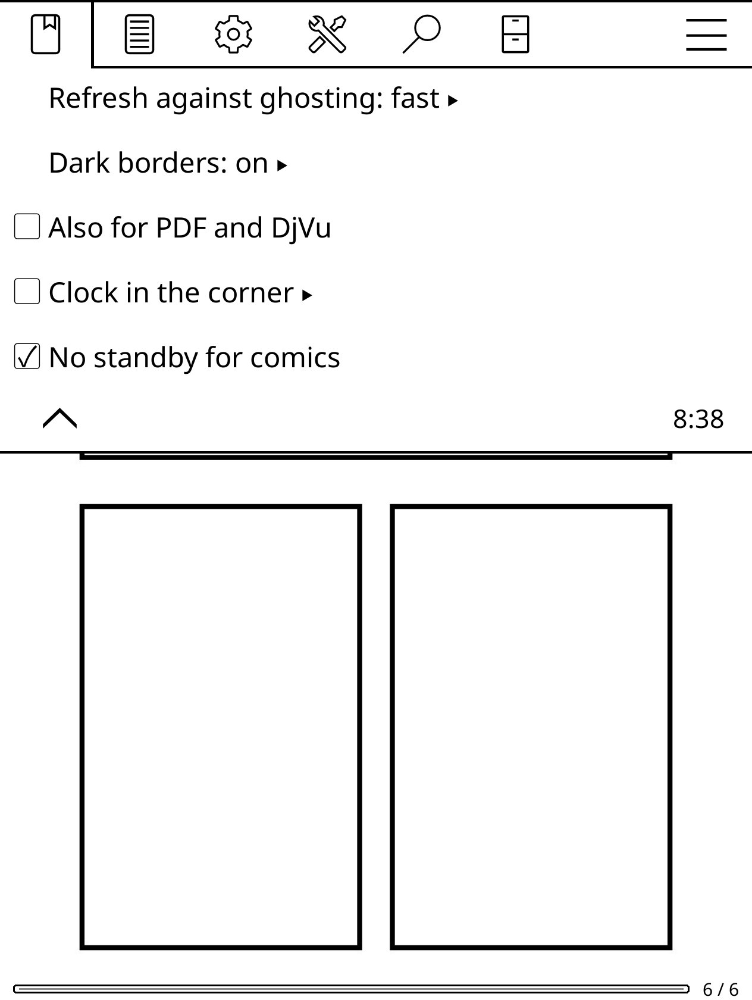
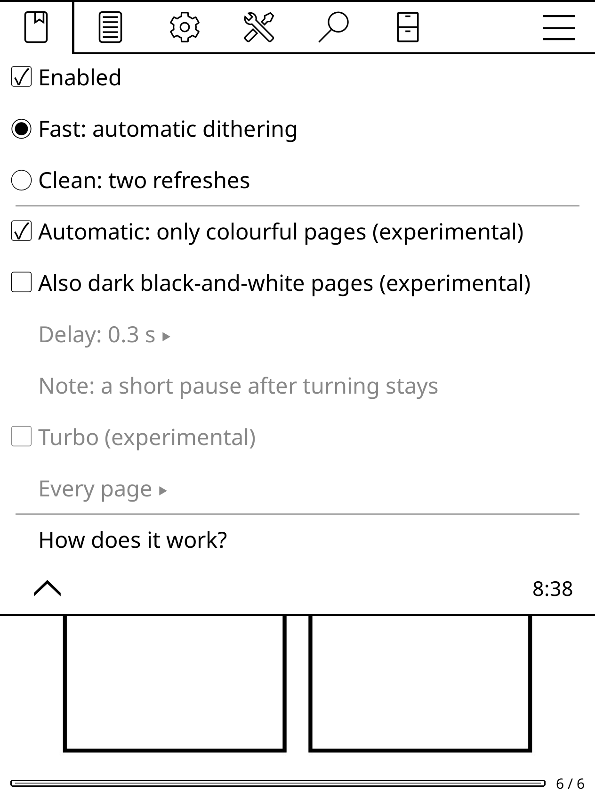
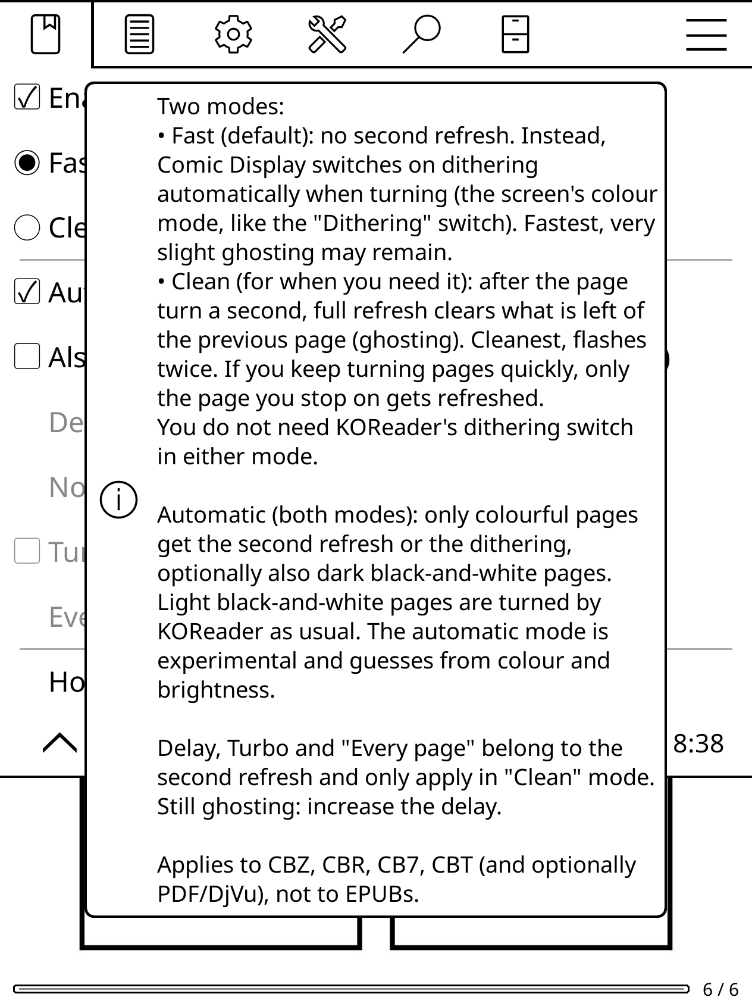
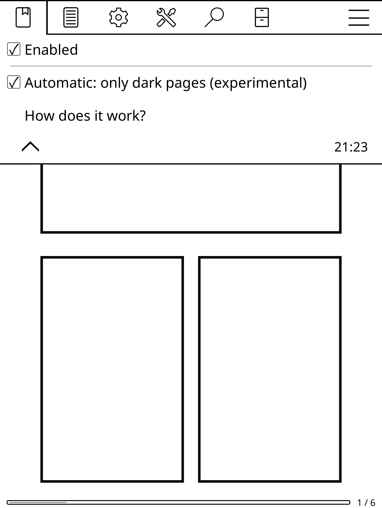
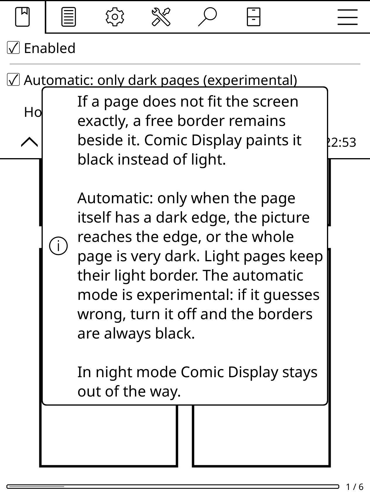

# Comic Display für KOReader

*English: [README.md](README.md)*

<!-- lang-note -->
*Funktioniert auf **Deutsch und Englisch**: Menüs und Texte richten sich nach der KOReader-Sprache.*

Ein KOReader-Plugin, mit dem Comics auf Farb-E-Ink besser aussehen. Es macht zwei Dinge, jedes mit eigenen Einstellungen:

- **Refresh gegen Ghosting:** Standardmäßig schaltet Comic Display beim Umblättern den Farbmodus des Bildschirms ein (schnell). Ein zweiter Voll-Refresh steht bereit, falls du ihn brauchst (sauber).
- **Dunkle Ränder:** Füllt eine Seite den Bildschirm nicht ganz, wird der freie Rand daneben schwarz statt hell. So stehen dunkle Seiten nicht in einem hellen Rahmen.

Beide teilen sich einen kurzen Blick auf jede Seite (Helligkeit, Farbe, Rand), die Seite wird also nur einmal gemessen.

- Es ändert keine KOReader-Dateien und übersteht deshalb Updates.
- Es wirkt nur bei Comics (CBZ, CBR, CB7, CBT). PDF und DjVu lassen sich zuschalten, EPUBs bleiben unberührt.

## Bildschirmfotos

*Die Bildschirmfotos zeigen die englische Oberfläche; in einem deutschen KOReader sind die Texte deutsch.*

<table>
<tr><td align="center" valign="top" width="33%"> Comic-Display-Menü</td><td align="center" valign="top" width="33%"> Refresh gegen Ghosting: Modus, Verzögerung, wie oft</td><td align="center" valign="top" width="33%"> Hilfetext: schneller gegen sauberer Refresh, Verzögerung, Turbo</td></tr>
<tr><td align="center" valign="top" width="33%"> Einstellungen für dunkle Ränder</td><td align="center" valign="top" width="33%"> Hilfetext: schwarze Ränder, Automatik</td><td align="center" valign="top" width="33%"> Uhrzeit in der Ecke: Akku, Ecke, Stil, Größe</td></tr>
</table>

## Refresh gegen Ghosting

Auf Farb-E-Ink (zum Beispiel Kobo Libra Colour) bleiben bei Comics oft Reste der vorigen Seite sichtbar, selbst wenn KOReader bei jeder Seite voll auffrischt. Comic Display hat zwei Wege dagegen:

- **Schnell: Dithering automatisch** (Standard, die empfohlene Einstellung): kein zweiter Refresh. Comic Display schaltet beim Umblättern den Farbmodus des Bildschirms ein (wie KOReaders Schalter „Dithering“), passend zu den Automatik-Einstellungen unten. Am schnellsten, ganz leichtes Ghosting kann bleiben. KOReaders Dithering-Schalter brauchst du nicht.
- **Sauber: zwei Refreshes** (nur noch da, falls du ihn wirklich mal brauchst): Gleich nach dem Zeichnen der neuen Seite folgt ein **zweiter** Voll-Refresh. Am saubersten, der Bildschirm blitzt aber zweimal. Blätterst du schnell weiter, wird nur die Seite aufgefrischt, auf der du stehen bleibst.

Einstellungen für beide Modi:

- **Automatik: nur farbige Seiten (experimentell)** (Standard: an). Experimentell wie alle Automatiken hier: Sie schätzt nach Farbe und Helligkeit. Ghosting sieht man vor allem auf farbigen Seiten. Die nächste Seite wird im Hintergrund geprüft, sobald KOReader sie vorgeladen hat.
- **Auch dunkle Schwarzweiß-Seiten (experimentell)** (Standard: aus). Für düstere Schwarzweiß-Comics.

Nur für den Modus „Sauber“:

- **Verzögerung:** standardmäßig 0,3 s. Probier „sofort“: Ist die Seite damit sauber, ist das am schnellsten. Bleibt Ghosting, die Verzögerung erhöhen. Eine kurze Pause bleibt immer: KOReader zeichnet erst die neue Seite, dann kann der zweite Refresh folgen.
- **Turbo** (nur mit „sofort“, experimentell): Die neue Seite wird zuerst im schnellsten Modus von KOReader gezeichnet, der saubere Voll-Refresh folgt gleich danach.
- **Wie oft:** bei jeder Seite (Standard) oder nur jede 2., 3. oder 5. Seite.

Tipp für „Sauber“: KOReaders eigenes „Voll-Refresh bei jeder Seite“ kannst du wieder auf einen normalen Wert stellen, zum Beispiel alle 6 Seiten, dann blitzt der Bildschirm einmal pro Seite statt zweimal.

## Dunkle Ränder

- **Automatisch: nur dunkle Seiten (experimentell)** (Standard: an). Der Rand wird schwarz, wenn die Seite selbst einen dunklen Rand hat oder das Bild bis an den Rand geht (Nachtszenen, schwarze Stege). Bei weißem Seitenrand nur, wenn die ganze Seite sehr dunkel ist. Helle Seiten behalten ihren hellen Rand. Eine kleine Pufferzone verhindert, dass es zwischen ähnlichen Seiten hin- und herspringt.
- Ohne Automatik sind die Ränder auf jeder Seite schwarz.
- Im Nachtmodus hält sich Comic Display heraus.

## Installation

1. Die ZIP-Datei unter [Releases](../../releases) herunterladen und entpacken, oder dieses Projekt herunterladen.
2. Den Ordner **`comicdisplay.koplugin`** in den `plugins`-Ordner von KOReader kopieren. Auf dem Kobo ist das `.adds/koreader/plugins/`.
3. KOReader neu starten.

## Einstellungen

Einen Comic öffnen, dann: oberes Menü → Werkzeug-Symbol → **Comic Display** (weit oben).

- **Refresh gegen Ghosting: schnell ▸** mit dem Modus (schnell oder sauber) und allen Refresh-Einstellungen
- **Dunkle Ränder: an ▸** mit eigenen Einstellungen
- **Uhrzeit in der Ecke:** Zeit, auf Wunsch mit Akku, in einer Ecke der Seite (Ecke, Größe und Stil: Kasten, schwarzer oder weißer Umriss). Ab Werk aus. Funktioniert auch mit ZenOS 4.3.
- **Auch bei PDF und DjVu** (für beides)

Jeder Bereich endet mit **„Wie funktioniert das?“**, einer kurzen Erklärung. Langes Drücken auf einen Eintrag zeigt seinen Hilfetext.

## Passt gut zu

- [Comic Panel Zoom](https://github.com/Akrota/koreader-comic-panel-zoom): hat einen eigenen Refresh beim Panelwechsel.
- [Comic Dual Page](https://github.com/Akrota/koreader-comic-dual-page): zwei Seiten nebeneinander im Querformat.

## Getestet auf

Kobo Libra Colour mit KOReader 2026.07.1 (auch mit ZenOS).

## Wer das gemacht hat

Den Code hat vollständig **Claude** geschrieben, eine KI von Anthropic (in Claude Code). Der Inhaber dieses Projekts hatte die Idee, hat das Plugin auf einem Kobo getestet und Rückmeldungen gegeben, aber keinen Code geschrieben.

Keine Gewährleistung und kein garantierter Support. Fehlermeldungen gern als [Issue](../../issues). Bitte `crash.log` aus dem KOReader-Ordner anhängen.

## Weitere Plugins

- [Levels / Tonwerte](https://github.com/Akrota/koreader-comic-levels): Tonwertkurve für Comics
- [Comic Panel Zoom](https://github.com/Akrota/koreader-comic-panel-zoom): Panel-für-Panel-Ansicht (Fork von JorgeTheFox)
- [Comic Dual Page](https://github.com/Akrota/koreader-comic-dual-page): Doppelseiten mit Erkennung (Fork von KORComic)
- [CBZ Converter](https://github.com/Akrota/koreader-cbz-converter): Comics, PDF und EPUB auf dem Gerät in CBZ umwandeln
- [Folder to series](https://github.com/Akrota/koreader-folder-to-series): Comic-Ordner zu Reihen mit Bandnummern
- [Drive Library](https://github.com/Akrota/koreader-drive-library): Google Drive als Cloud-Bibliothek
- [Story Recall](https://github.com/Akrota/koreader-story-recall): Spoilerfreier KI-Rückblick auf Bücher
- [Guitar Tab Reader](https://github.com/Akrota/koreader-guitar-tab-reader): Gitarren-Tabs und Chords für E-Ink
- [Wi-Fi while charging](https://github.com/Akrota/koreader-wifi-while-charging): WLAN anlassen, solange das Gerät lädt
- [Zen page browser gesture](https://github.com/Akrota/koreader-zen-page-browser-gesture): Geste für den ZenOS-Seitenbrowser

## Lizenz

[MIT](LICENSE)
