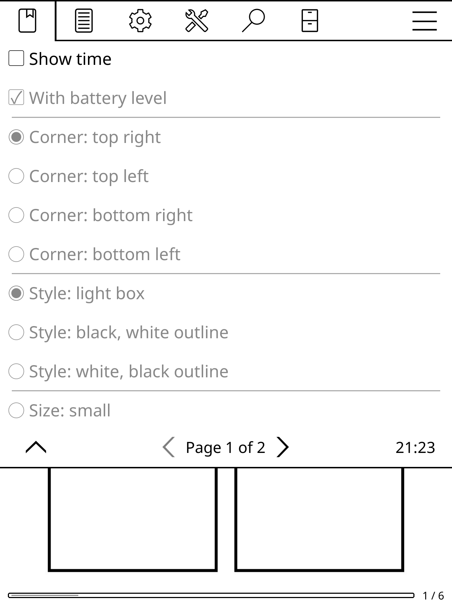

# Comic Display für KOReader

*English: [README.md](README.md)*

Ein KOReader-Plugin, mit dem Comics auf Farb-E-Ink besser aussehen. Es macht zwei Dinge, jedes mit eigenen Einstellungen:

- **Refresh gegen Ghosting:** Direkt nach dem Umblättern räumt ein zweiter Voll-Refresh auf, was von der vorigen Seite übrig ist.
- **Dunkle Ränder:** Füllt eine Seite den Bildschirm nicht ganz, wird der freie Rand daneben schwarz statt hell. So stehen dunkle Seiten nicht in einem hellen Rahmen.

Beide teilen sich einen kurzen Blick auf jede Seite (Helligkeit, Farbe, Rand), die Seite wird also nur einmal gemessen.

- Es ändert keine KOReader-Dateien und übersteht deshalb Updates.
- Es wirkt nur bei Comics (CBZ, CBR, CB7, CBT). PDF und DjVu lassen sich zuschalten, EPUBs bleiben unberührt.

## Bildschirmfotos

 
 
 
 

## Refresh gegen Ghosting

Auf Farb-E-Ink (zum Beispiel dem Kobo Libra Colour) bleiben bei Comics oft Reste der vorigen Seite sichtbar, auch wenn KOReader bei jeder Seite voll auffrischt. Comic Display löst einen **zweiten** Voll-Refresh aus, sobald die neue Seite gezeichnet ist.

- Blätterst du schnell weiter, entfällt ein noch wartender Refresh. Nur die Seite, auf der du stehen bleibst, wird aufgefrischt.
- **Automatisch: nur farbige Seiten (experimentell)** (Standard: an). Experimentell, wie alle Automatiken hier: Sie schätzt nach Farbe und Helligkeit. Ghosting sieht man vor allem auf farbigen Seiten. Schwarzweiß-Seiten frischt KOReader ganz normal auf, ohne das zusätzliche Blitzen. Die nächste Seite wird schon im Hintergrund geprüft, sobald KOReader sie vorgeladen hat.
- **Auch dunkle Schwarzweiß-Seiten (experimentell)** (Standard: aus). Für düstere Schwarzweiß-Comics: Sehr dunkle Seiten bekommen den Extra-Refresh ebenfalls.
- **Verzögerung:** standardmäßig 0,3 s. Probier „sofort“: Ist die Seite damit sauber, ist das am schnellsten. Bleibt Ghosting, die Verzögerung erhöhen.
- Direkt darunter erklärt ein Hinweis, warum eine kurze Pause nach dem Blättern immer bleibt: KOReader zeichnet zuerst die neue Seite, erst danach kann der zweite Refresh folgen.
- **Zwei Modi:** **Sauber** (Standard): ein zweiter, voller Refresh nach dem Umblättern, am saubersten. **Schnell: Dithering automatisch**: kein zweiter Refresh, stattdessen schaltet Comic Display beim Umblättern den Farbmodus des Bildschirms ein (wie KOReaders Schalter „Dithering“), passend zu den Automatik-Einstellungen. Am schnellsten, ganz leichtes Ghosting kann bleiben. KOReaders Dithering-Schalter brauchst du in keinem Modus.
- **Turbo** (nur mit „sofort“, experimentell): Die neue Seite wird zuerst im schnellsten Modus von KOReader gezeichnet, der saubere Voll-Refresh folgt gleich danach.
- **Wie oft:** jede Seite (Standard) oder nur jede 2., 3. oder 5. Seite.

Tipp: KOReaders eigenes „Voll-Refresh bei jeder Seite“ kannst du wieder auf einen normalen Wert stellen, zum Beispiel alle 6 Seiten. Comic Display sorgt ohnehin für ein sauberes Bild, so blitzt der Bildschirm einmal pro Seite statt zweimal.

## Dunkle Ränder

- **Automatisch: nur dunkle Seiten (experimentell)** (Standard: an). Der Rand wird schwarz, wenn die Seite selbst einen dunklen Rand hat oder das Bild bis an den Rand geht (Nachtszenen, schwarze Stege). Bei weißem Seitenrand nur, wenn die ganze Seite sehr dunkel ist. Helle Seiten behalten ihren hellen Rand. Eine kleine Pufferzone verhindert, dass es zwischen ähnlichen Seiten hin- und herspringt.
- Ohne Automatik sind die Ränder auf jeder Seite schwarz.
- Im Nachtmodus hält sich Comic Display heraus.

## Installation

1. Die ZIP-Datei unter [Releases](../../releases) herunterladen und entpacken, oder dieses Projekt herunterladen.
2. Den Ordner **`comicdisplay.koplugin`** in den `plugins`-Ordner von KOReader kopieren. Auf dem Kobo ist das `.adds/koreader/plugins/`.
3. KOReader neu starten.

## Einstellungen

Einen Comic öffnen, dann: oberes Menü → Werkzeug-Symbol → **Comic Display** (weit oben).

- **Refresh gegen Ghosting: sauber ▸** mit dem Modus (sauber oder schnell) und allen Refresh-Einstellungen
- **Dunkle Ränder: an ▸** mit eigenen Einstellungen
- **Uhrzeit in der Ecke:** Zeit, auf Wunsch mit Akku, in einer Ecke der Seite (Ecke, Größe und Stil: Kasten, schwarzer oder weißer Umriss). Ab Werk aus. Funktioniert auch mit ZenOS 4.3.
- **Auch bei PDF und DjVu** (für beides)

Jeder Bereich endet mit **„Wie funktioniert das?“**, einer kurzen Erklärung. Langes Drücken auf einen Eintrag zeigt seinen Hilfetext.

## Passt gut zu

- [Comic Panel Zoom](https://github.com/Akrota/koreader-comic-panel-zoom): hat einen eigenen Refresh beim Panelwechsel.
- [Comic Dual Page](https://github.com/Akrota/koreader-comic-dual-page): zwei Seiten nebeneinander im Querformat.

## Getestet auf

Kobo Libra Colour mit KOReader 2026.07.1 (auch mit ZenOS).

## Wer das gemacht hat

Den Code hat vollständig **Claude** geschrieben, eine KI von Anthropic (in Claude Code). Der Inhaber dieses Projekts hatte die Idee, hat das Plugin auf einem Kobo getestet und Rückmeldungen gegeben, aber keinen Code geschrieben.

Keine Gewährleistung und kein garantierter Support. Fehlermeldungen gern als [Issue](../../issues). Bitte `crash.log` aus dem KOReader-Ordner anhängen.

## Lizenz

[MIT](LICENSE)
