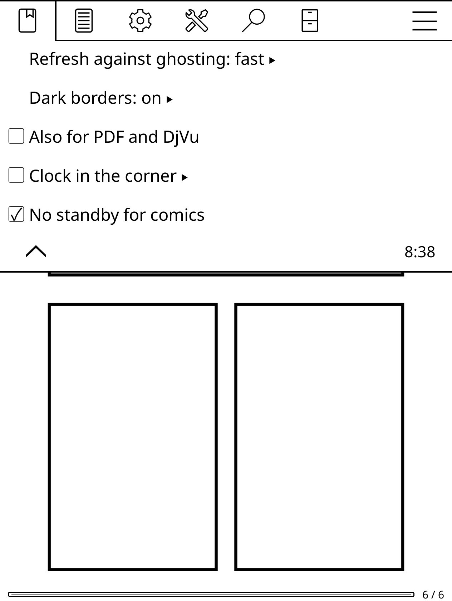
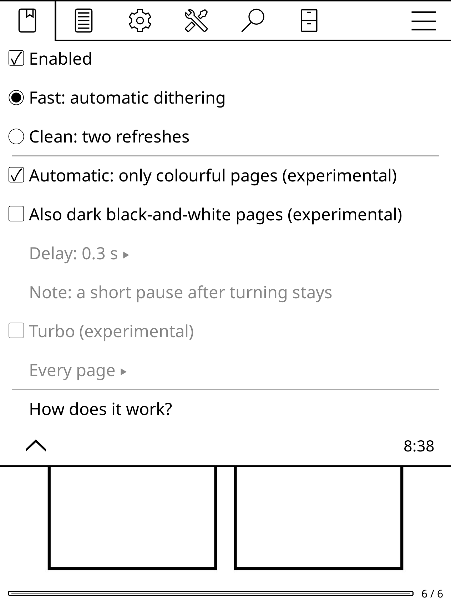
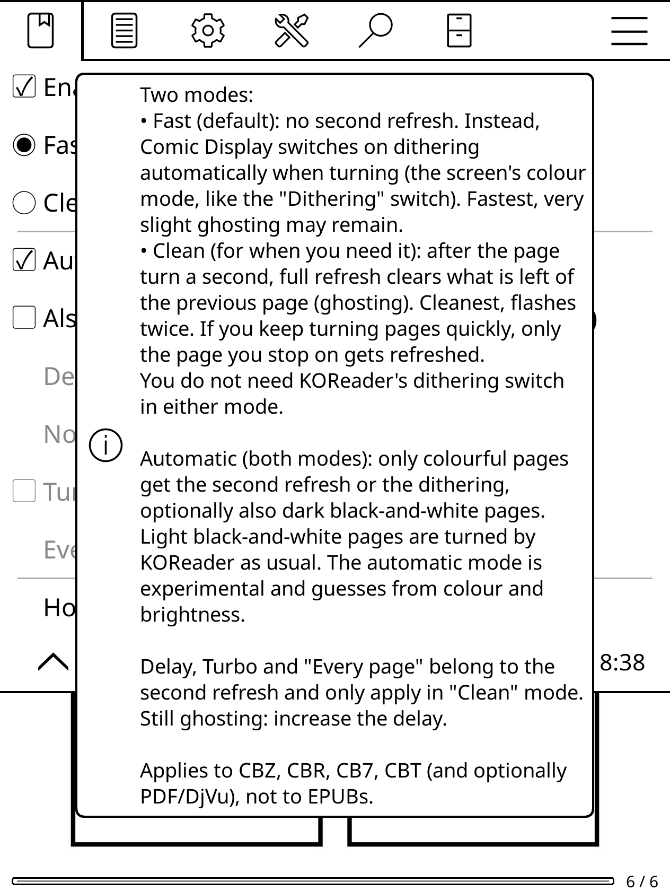
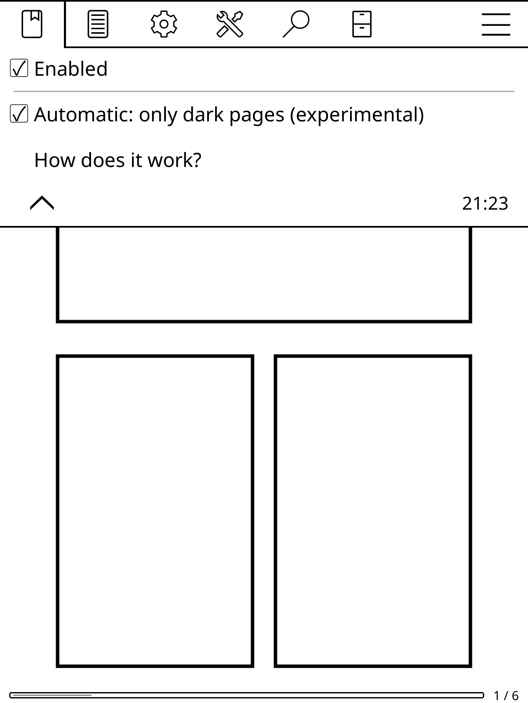
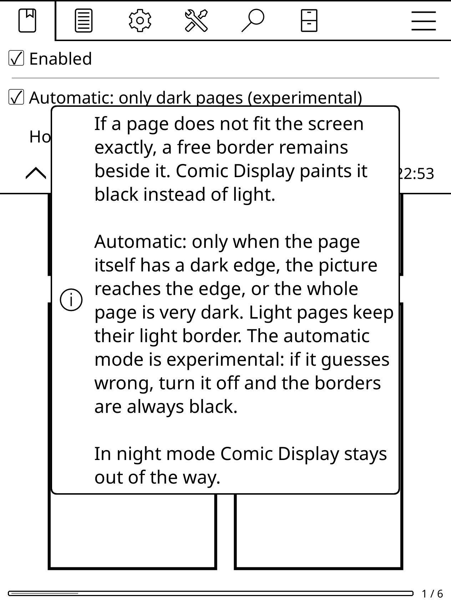
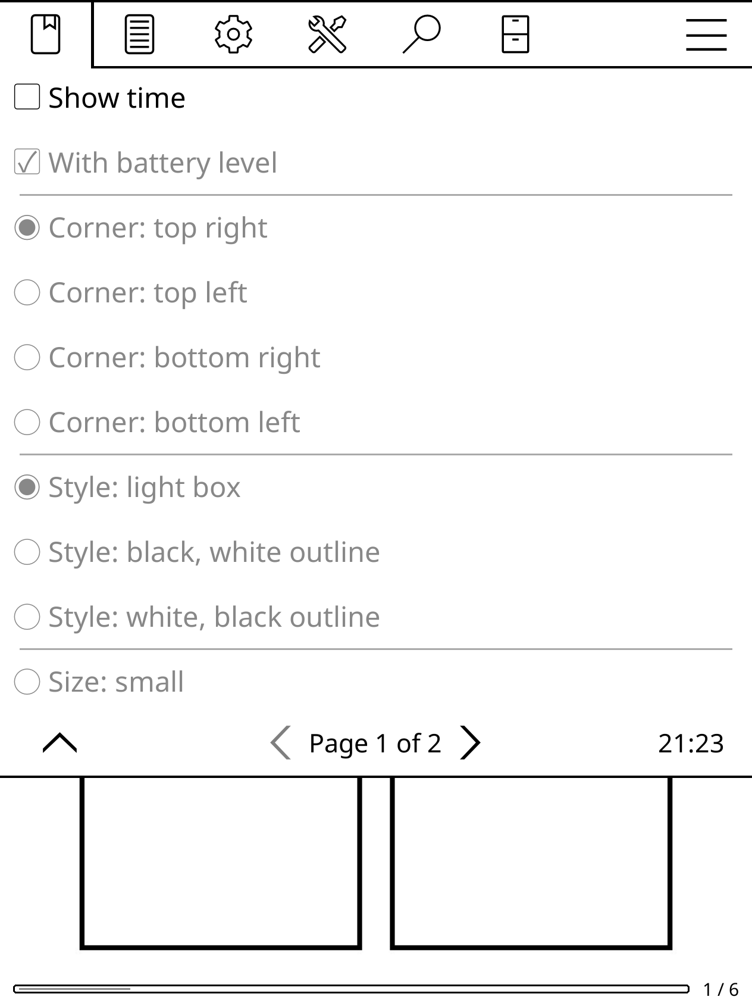

# Comic Display for KOReader

*Deutsch: [README.de.md](README.de.md)*

<!-- lang-note -->
*Works in **English and German**: menus and texts follow KOReader's language. A German description is at the bottom of this page.*

A KOReader plugin that makes comics look better on colour e-ink. It does two things, each with its own settings:

- **Refresh against ghosting:** by default Comic Display switches on the screen's colour mode when you turn a page (fast). A second full refresh is available for when you need it (clean).
- **Dark borders:** when a page doesn't fill the screen, the free border beside it is painted black instead of light, so dark pages don't sit in a bright frame.

Both share one quick look at each page (brightness, colour, edge), so the page is only measured once.

- It doesn't change any KOReader files, so it survives updates.
- It is only active for comics (CBZ, CBR, CB7, CBT). PDF and DjVu can be switched on, and EPUBs are not affected.

## Screenshots

*The screenshots show the English interface; in a German KOReader the texts are German.*

<table>
<tr><td align="center" valign="top" width="33%"> Comic Display menu</td><td align="center" valign="top" width="33%"> Refresh against ghosting: mode, delay, how often</td><td align="center" valign="top" width="33%"> Help text: fast versus clean refresh, delay, turbo</td></tr>
<tr><td align="center" valign="top" width="33%"> Dark borders settings</td><td align="center" valign="top" width="33%"> Help text: black borders, automatic mode</td><td align="center" valign="top" width="33%"> Clock in the corner: battery, corner, style, size</td></tr>
</table>

## Refresh against ghosting

On colour e-ink (for example the Kobo Libra Colour), remnants of the previous page often stay visible in comics, even when KOReader does a full refresh on every page. Comic Display has two ways to deal with that:

- **Fast: automatic dithering** (default, the recommended one): no second refresh. Comic Display switches on the screen's colour mode when you turn the page (like KOReader's "Dithering" switch), following the automatic settings below. Fastest, very slight ghosting may remain. You don't need KOReader's dithering switch.
- **Clean: two refreshes** (kept for when you really need it): a **second** full refresh follows as soon as the new page is drawn. Cleanest, but the screen flashes twice. When you turn pages quickly, a pending refresh is dropped, only the page you stop on gets refreshed.

Settings for both modes:

- **Automatic: only colourful pages (experimental)** (default: on). Experimental, like all automatic options here: it guesses from colour and brightness. Ghosting is mainly visible on colourful pages. The next page is checked in the background as soon as KOReader has preloaded it.
- **Also dark black-and-white pages (experimental)** (default: off). For gloomy black-and-white comics.

Only for the clean mode:

- **Delay:** 0.3 s by default. Try "immediately": if the page is clean with it, that's the fastest option. If ghosting remains, increase the delay. A short pause always stays: KOReader draws the new page first, only then can the second refresh follow.
- **Turbo** (only with "immediately", experimental): the new page is first drawn in KOReader's fastest mode, the clean full refresh follows right after.
- **How often:** every page (default), or only every 2nd, 3rd or 5th page.

Tip for the clean mode: you can set KOReader's own "full refresh on every page" back to a normal value, for example every 6 pages, so the screen flashes once per page instead of twice.

## Dark borders

- **Automatic: only dark pages (experimental)** (default: on). The border turns black when the page itself has a dark edge or the picture reaches the edge (night scenes, black gutters). With a white edge only when the whole page is very dark. Light pages keep their light border. A small buffer stops it from switching back and forth between similar pages.
- Turn the automatic mode off to have black borders on every page.
- In night mode Comic Display stays out of the way.

## Installation

1. Download the ZIP from [Releases](../../releases) and unpack it, or download this repository.
2. Copy the folder **`comicdisplay.koplugin`** to KOReader's `plugins` folder. On a Kobo, that is `.adds/koreader/plugins/`.
3. Restart KOReader.

## Settings

Open a comic, then go to: top menu → tools icon (wrench) → **Comic Display** (near the top).

- **Refresh against ghosting: fast ▸** with the mode (fast or clean) and all refresh settings
- **Dark borders: on ▸** with its own settings
- **Clock in the corner:** time, optionally with battery, in a corner of the page (corner, size, and style: box, black outline or white outline). Off by default. Works with ZenOS 4.3 too.
- **Also for PDF and DjVu** (for both)

Each part ends with **"How does it work?"**, a short explanation. Long-press an entry for its help text.

## Works well with

- [Comic Panel Zoom](https://github.com/Akrota/koreader-comic-panel-zoom): has its own refresh on panel change.
- [Comic Dual Page](https://github.com/Akrota/koreader-comic-dual-page): two pages side by side in landscape.

## Tested on

Kobo Libra Colour with KOReader 2026.07.1 (also with ZenOS).

## Who made this

The code was written entirely by **Claude**, an AI by Anthropic (in Claude Code). The owner of this repository came up with the idea, tested the plugin on a Kobo and gave feedback, but did not write the code.

There is no warranty and no guaranteed support. Bug reports are welcome as [issues](../../issues). Please attach `crash.log` from the KOReader folder.

## More plugins

- [Levels / Tonwerte](https://github.com/Akrota/koreader-comic-levels): Tone curve for comics
- [Comic Panel Zoom](https://github.com/Akrota/koreader-comic-panel-zoom): Panel-by-panel view (fork of JorgeTheFox's plugin)
- [Comic Dual Page](https://github.com/Akrota/koreader-comic-dual-page): Double pages with detection (fork of KORComic)
- [CBZ Converter](https://github.com/Akrota/koreader-cbz-converter): Convert comics, PDF and EPUB to CBZ on the device
- [Folder to series](https://github.com/Akrota/koreader-folder-to-series): Comic folders to series with volume numbers
- [Drive Library](https://github.com/Akrota/koreader-drive-library): Google Drive as a cloud library
- [Story Recall](https://github.com/Akrota/koreader-story-recall): Spoiler-free AI recap for books
- [Guitar Tab Reader](https://github.com/Akrota/koreader-guitar-tab-reader): Guitar tabs and chords for e-ink
- [Wi-Fi while charging](https://github.com/Akrota/koreader-wifi-while-charging): Keep Wi-Fi on while charging
- [Zen page browser gesture](https://github.com/Akrota/koreader-zen-page-browser-gesture): Gesture for the ZenOS page browser

## License

[MIT](LICENSE)

---

## Deutsch (Kurzbeschreibung)

Ein KOReader-Plugin, mit dem Comics auf Farb-E-Ink besser aussehen. Es macht zwei Dinge, jedes mit eigenen Einstellungen:

- **Refresh gegen Ghosting:** Standardmäßig schaltet Comic Display beim Umblättern den Farbmodus des Bildschirms ein (schnell). Ein zweiter Voll-Refresh steht bereit, falls du ihn brauchst (sauber).
- **Dunkle Ränder:** Füllt eine Seite den Bildschirm nicht ganz, wird der freie Rand daneben schwarz statt hell. So stehen dunkle Seiten nicht in einem hellen Rahmen.

Beide teilen sich einen kurzen Blick auf jede Seite (Helligkeit, Farbe, Rand), die Seite wird also nur einmal gemessen.

- Es ändert keine KOReader-Dateien und übersteht deshalb Updates.
- Es wirkt nur bei Comics (CBZ, CBR, CB7, CBT). PDF und DjVu lassen sich zuschalten, EPUBs bleiben unberührt.

Die ausführliche deutsche Anleitung steht in der [README.de.md](README.de.md).
